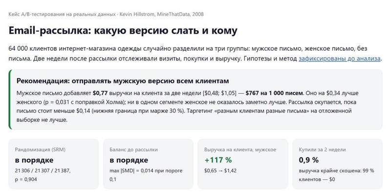
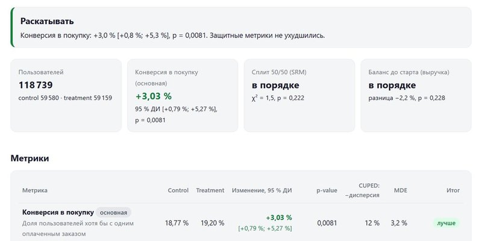
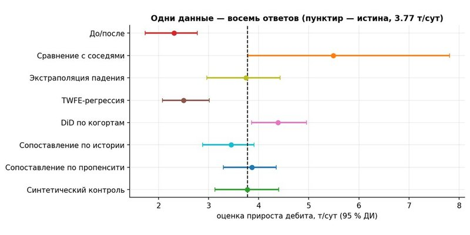
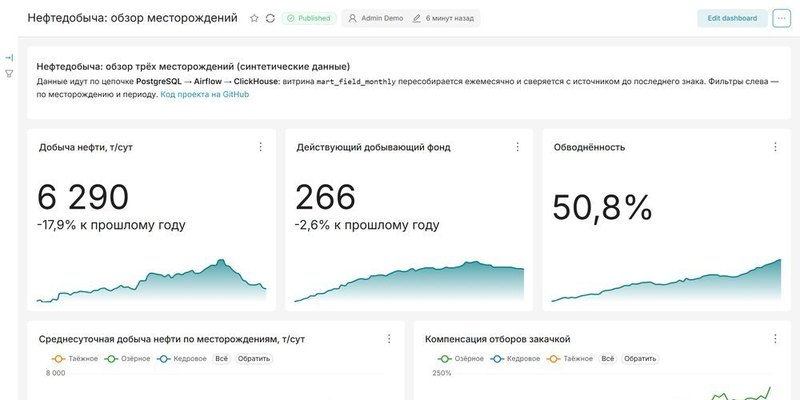

<h1 align="center">Александр Федоров</h1>

  <b>Аналитик данных и руководитель проектов · 11+ лет в нефтегазе</b> 
  A/B-тесты · причинный анализ · SQL и Python · инженерия данных

  <a href="https://alex91132.github.io/"><b>Портфолио</b></a> ·
  <a href="https://alex91132.github.io/assets/rezume-fedorov.pdf">Резюме (PDF)</a> ·
  <a href="https://t.me/Alex91132">Telegram</a> ·
  <a href="mailto:alexandr91132@gmail.com">alexandr91132@gmail.com</a>

---

10+ лет был инженером-нефтяником: бурение, ГРП, планирование скважин. Сейчас веду разработку
ИИ-помощников и расчётных продуктов для нефтегазовой отрасли — собираю требования у экспертов,
готовлю данные, валидирую модели, руковожу командой разработки.

В pet-проектах беру задачи, которые решаются на работе, и довожу их до конца: план анализа,
проверка методов на данных с известным ответом, тесты, CI, живая демо и записка с решением.

## Проекты

<table>
  <tr>
    <td width="50%" valign="top">
      
       <b>A/B-кейс на реальных данных: какую рассылку слать и кому</b>
       64 000 клиентов, три группы. План анализа закоммичен до результатов, поправка Холма,
      бутстреп, экономика, таргетинг на отложенной выборке. Итог — <b>+$767&nbsp;на&nbsp;1&nbsp;000&nbsp;писем</b>.
       <a href="https://alex91132.github.io/ab-case-email-campaign/">Записка</a> ·
      <a href="https://github.com/Alex91132/ab-case-email-campaign">Код</a>
    </td>
    <td width="50%" valign="top">
      
       <b>Движок анализа A/B-экспериментов</b>
       Логи → DuckDB → метрики на SQL → SRM, CUPED, дельта-метод, Холм, mSPRT и
      О'Брайен — Флеминг → HTML-отчёт. Каждый метод проверен на 3 000 симулированных экспериментов.
       <a href="https://alex91132.github.io/ab-testing-engine/">Отчёты</a> ·
      <a href="https://github.com/Alex91132/ab-testing-engine">Код</a>
    </td>
  </tr>
  <tr>
    <td width="50%" valign="top">
      
       <b>Сколько нефти дал ГРП: причинный анализ</b>
       8 методов — от «до/после» до синтетического контроля — против известной истины.
      Монте-Карло: «до/после» занижает эффект на треть, подбор контрольной группы ошибается на 1–2 %.
       <a href="https://alex91132.github.io/gtm-causal-inference/">Демо</a> ·
      <a href="https://github.com/Alex91132/gtm-causal-inference">Код</a>
    </td>
    <td width="50%" valign="top">
      
       <b>Платформа данных нефтедобычи</b>
       PostgreSQL → Airflow → ClickHouse → Superset. Целостность на уровне БД, партиционирование,
      идемпотентный ETL со сверкой с источником, дашборд «как код». Поднимается одной командой в Docker.
       <a href="https://github.com/Alex91132/oil-production-dwh">Код</a>
    </td>
  </tr>
</table>

**Ещё:**

* [Симулятор A/B-тестов](https://alex91132.github.io/ab-simulator/) — размер выборки, мощность, Монте-Карло на чистом JS
* [Ковёр бурения](https://alex91132.github.io/drilling-carpet/) — график движения буровых установок из Excel
* [REST API на FastAPI](https://github.com/Alex91132/houses_ms) — каталог объектов, в разработке

## Стек

 

 

**Методы:** A/B-тесты (SRM, CUPED, дельта-метод, последовательный анализ, множественные сравнения),
причинный анализ (DiD, сопоставление по пропенсити, синтетический контроль), бутстреп, Монте-Карло,
валидация ML-моделей.

<b>In English</b>

 

Data analyst and project lead with 11+ years in oil & gas — drilling, hydraulic fracturing, well planning.
Today I lead development of AI assistants and engineering calculation products for the industry:
gathering requirements from domain experts, preparing data, validating models, managing the dev team.

Pet projects: an A/B-testing engine in Python (SRM, CUPED, delta method, mSPRT, O'Brien–Fleming, every
method validated by simulation), a real-data A/B case with a pre-registered analysis plan, causal inference
for oil-well treatments (8 estimators benchmarked against known ground truth), and an oil production data
platform (PostgreSQL → Airflow → ClickHouse → Superset). Docs are in Russian; numbers, code and tests are universal.

Open to relocation and remote work.
[Portfolio](https://alex91132.github.io/) · [Telegram](https://t.me/Alex91132) · alexandr91132@gmail.com

